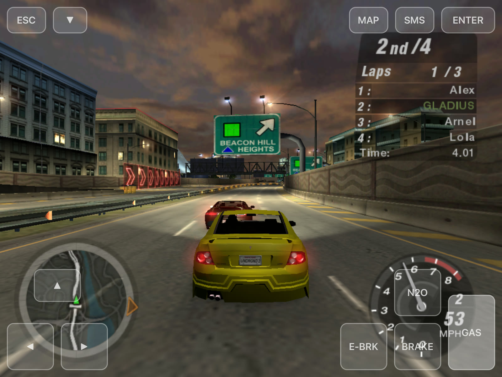
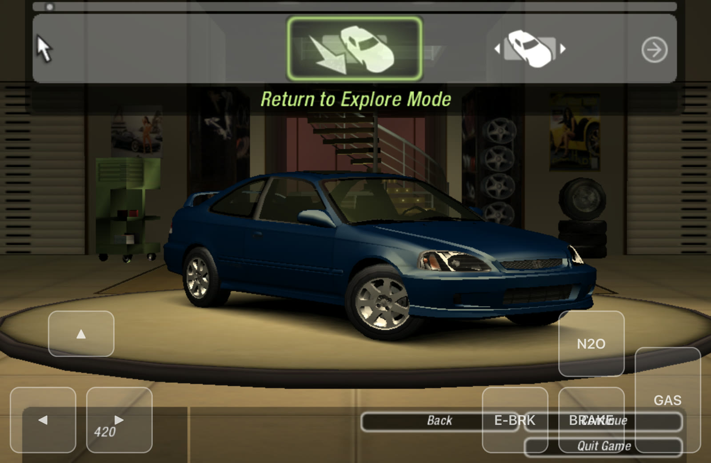

# Need for Speed: Underground 2 on iOS — native port for the iPad mini 2

**The original PC *Need for Speed: Underground 2* (2004), recompiled to native ARM64
and running on a jailbroken iPad mini 2 (A7, 1 GB RAM, iOS 12.5.8).** No emulator,
no JIT, no Wine: the game's own code, with Direct3D 9 translated to Metal.

This is the `ios` branch of a fork of [NFSU2Recomp](https://github.com/TalhaMudo/NFSU2Recomp),
Talha Müderrisoğlu's native Apple Silicon **macOS** port. The recompiled game code is
the same as the macOS build of the North American v1.2 `SPEED2.EXE`. This branch
replaces the platform layer for iOS: UIKit app shell, touch controls, A7 GPU limits,
memory, audio, storage. All iOS changes are behind `TARGET_OS_IPHONE`, so the macOS
build still works (see [The macOS port](#the-macos-port)).

> **This repository contains no game code and no game assets.** You need your own
> copy of the PC game. The C code generated from its executable (`gen/`), every build
> (`out/`) and the game data never go into git.





*Screenshots taken on the iPad mini 2: a career race with the on-screen controls,
and the garage.*

## Status

**The full game runs on the iPad mini 2:** boot, intro movies, menus, career mode
(free roam, races, shops, saves) and Quick Race, with sound, touch controls and the
original rendering.

| Area | State |
|---|---|
| Frame rate | **Stable 60 fps on low settings**; about 30 fps, dipping towards 20, with everything maxed out. Menus: 60 fps. |
| Memory | Peak 376–425 MB in scripted races (budget: under 450 MB; the first build used 570 MB). Long free-roam sessions have reached ~490–500 MB, which is being worked on. |
| Game data on the device | 1.7 GB with movies, down from 2.2 GB, using lossless compression (`ios/pack_data.py`). Loads are faster too. |
| Movies | Play with the game's own VP6 decoder; tap to skip the ones the game lets you skip. |
| Sound | Music and effects without stutter. |
| Controls | Touch acts as the mouse in menus. On-screen steering, gas, brake, e-brake, N2O, Esc and Enter are always there. **Gear ▲/▼** appear in drag races or with manual transmission. **Map** and **SMS** appear while driving. MFi controllers are supported. |
| Text entry | The iOS keyboard comes up for the profile name. |
| Device | iPad mini 2 tested. The **iPhone SE (2016)** (A9, 2 GB) is the next device. |

More optimisation is on the way: render-pass and bandwidth work for the tile-based GPU,
textures and memory.

### Known issues

- Car showroom loading hang: a fix (the game clock kept moving through long loads)
  is installed and being verified.
- Memory can pass 450 MB in long free-roam sessions (open-world textures).
- Rootful jailbreak required: the app needs entitlements a normal sideload cannot
  give it, and the device must have SSH.
- The macOS port's limitations also apply (see [The macOS port](#the-macos-port)).

## What the iOS port changes

The full table is in [`ios/README.md`](ios/README.md). In short:

- **App shell.** UIKit owns the main thread. The original boot code runs on its own
  thread and starts the game thread (1 GB stack), then runs the Metal frame loop.
- **Guest memory.** The game's 4 GB address space is a zero-fill section inside the
  executable. With iOS's default 4 GB `__PAGEZERO` there isn't enough contiguous
  space, and a smaller pagezero clashes with the jailbreak's injected library.
- **A7 GPU (Metal family 1).** There is no BC texture support, so DXT is decoded on
  upload (DXT1 to 16-bit). Large mip levels are dropped. Base vertex and mirror-clamp
  are emulated.
- **Memory.** Textures are freed when the game releases them. DXT data is dropped
  from guest memory after upload. Free guest pages go back to the OS, and
  quarantines are smaller.
- **Audio and scheduling.** RemoteIO output and a smooth DirectSound play cursor. A
  fair (FIFO) game lock and a high-priority timer thread fixed music cutting out.
- **Movies.** EA's CPU-speed probe and movie audio watchdog needed real time and a
  moving play cursor. A tap acts as Enter.
- **Input.** On-screen keys send DirectInput scan codes. The gear, map and SMS keys
  read the game's own active key bindings. The drag-race and manual-transmission
  checks use the same game settings that pick the drag HUD and the Transmission
  option.
- **Data.** `ios/pack_data.py` stores the files that compress well as NFZ1 (128 KB
  LZFSE blocks). `runtime/fileio.c` reads them transparently.
- **Lifecycle.** The frame loop pauses in the background. A battery guard exits at
  < 8 % unplugged or < 5 % charging, because a flat battery reboots the device and
  loses the jailbreak. A watchdog writes a hang report after 20 s without a frame,
  and a three-finger tap writes one on demand.

## Requirements

- A jailbroken 64-bit iOS device (rootful; tested: iPad mini 2 on iOS 12.5.8) with SSH
  and `uicache`. Set up an SSH host alias for it (the scripts default to `ipadmini2`).
- A Mac with Xcode (iOS SDK), `ldid` (Homebrew) and Python 3 with `capstone` 5.x and
  `pefile` (`requirements.txt`).
- Your own copy of the PC game with the **North American v1.2** `SPEED2.EXE`
  (4,800,512 bytes, SHA-256
  `f9dd86c054878ce6276beb07c1fd61874f7a1e4bf1f241b084c65b73e24168a7`). The app
  checks it at startup. The US v1.0 disc executable is copy-protected and cannot be
  used, and this project does not remove copy protection.

## Build and install

Run everything from the repository root.

```bash
python3 -m venv .venv && .venv/bin/pip install -r requirements.txt
GAME="/path/to/Need for Speed Underground 2"        # folder containing SPEED2.EXE

tools/gen_v2.sh "$GAME/SPEED2.EXE"           # lift the NA exe to C -> gen/na
ios/build_ios.sh                             # shards + runtime -> out/ios/NFSU2.app
python3 ios/pack_data.py "$GAME"             # smaller, lossless copy of the data -> out/ios-data
ios/push_data.sh out/ios-data ipadmini2      # resumable copy to /var/mobile/Media/NFSU2
ios/install.sh ipadmini2                     # staged install into /Applications + uicache
ssh ipadmini2 uiopen -b com.legacylab.nfsu2  # or tap the icon
```

- `ios/build_ios.sh rt` rebuilds only the runtime once the shards are built.
- **`ios/pack_data.py`** only reads your game folder. It writes a full copy in which
  track world data, car and wheel models, front-end and cutscene files are compressed
  without loss, and checks that every packed file decompresses to the original. The
  other files are APFS clones, so the copy costs almost no space on the Mac. Music,
  movies, vinyls and speech are already compressed and stay as they are.
  2.07 GB becomes 1.64 GB. Pushing the unpacked game folder works too.
- The app icon is generated at build time from `ICON=<square image>`. No logo is
  committed.
- `out/ios/NFSU2.dSYM` symbolicates device crash reports.
- Re-sign with `ldid -Sios/entitlements.plist -Icom.legacylab.nfsu2`. Without `-I`
  the app gets a new, empty data container.

### Playing

- Game data, saves, the log (`nfsu2.log`) and `env.txt` are in
  `/var/mobile/Media/NFSU2`.
- `env.txt` holds `KEY=VALUE` overrides, one per line. Examples:
  - `NFSRES=1024x768` (render size)
  - `NFSU2_GEARKEYS=1` (always show the gear keys)
  - `NFSU2_KEY_GAS=0xC8` (remap an on-screen key, DIK hex)
  - `NOMOVIES=1`

  The full list is in [`ios/README.md`](ios/README.md).
- If the game hangs, tap the screen with three fingers; a report goes to
  `nfsu2.log`.

## How it works

```
SPEED2.EXE (PE32, x86)
   │  tools/reloc2.py     recover the relocation table
   │  tools/genall.py     recursive-descent discovery + tools/lift.py
   ▼                      x86 → C, one C function per guest function
gen/na/shard_*.c + fntab.c (guest address → native function)
   │  ios/build_ios.sh    clang -O2 -mcpu=cyclone, arm64-apple-ios12.0
   ▼
runtime/  (hand-written)  CPU state, guest memory, Win32, D3D9→Metal, audio,
   │                      ios_app.m (UIKit shell), bundle_ios.m (paths)
   ▼
out/ios/NFSU2.app         ~33 MB arm64 executable + the 4 GB zero-fill guest section
```

- **Pointers vs. constants.** The hard part of x86 static recompilation is telling a
  4-byte address from a 4-byte number. The executable's relocation directory entry
  is zeroed, but the relocation data is still there; `tools/reloc2.py` parses it by
  hand (91,106 absolute addresses), and function discovery and jump tables are
  seeded from it.
- **Guest memory.** One 32-bit address space; translating a guest address to a host
  one is a single ARM64 addressing mode.
- **Indirect calls** go through an O(1) table indexed by guest address.
- **Code generated at run time** (small x86 thunks the game writes to its stack)
  runs in a small interpreter (`runtime/genexec.c`).
- **D3DX effects** are partly replaced by hand-written code (`runtime/d3dx_hle.c`,
  `D3DX_HLE.md`).

| Path | What it is |
|---|---|
| `ios/` | iOS build, install, data packing and push scripts; `ios/README.md` |
| `runtime/ios_app.m`, `bundle_ios.m` | UIKit shell, touch controls, paths and defaults |
| `runtime/metal.m` | Direct3D 9 → Metal renderer (A7 paths under `TARGET_OS_IPHONE`) |
| `runtime/com.c`, `vsemu.c` | Direct3D 9 / DirectInput / DirectSound COM layer, shader translation |
| `runtime/audio.m` | CoreAudio output (RemoteIO on iOS) |
| `runtime/win32.c`, `win32_ext.c`, `fileio.c`, `res.c` | Win32 API layer (`fileio.c` also reads NFZ1 packed files) |
| `runtime/cpu.h`, `mem.c`, `dispatch.c`, `genexec.c` | CPU state, guest memory, dispatch, run-time code |
| `tools/lift.py`, `genall.py`, `reloc2.py` | x86-32 → C lifter, function discovery, relocation recovery |
| `tests/boot.c` | program entry point (runs the game from its PE entry point) |

## The macOS port

This fork keeps the upstream macOS port intact. On Apple Silicon Macs it runs races
at 119 fps on an M1 Pro (the display's limit), against 10–15 fps under Wine. It has
a launcher app, an optional HD build (MSAA, SSR, ray-traced reflections), and
supports both the European and North American v1.2 executables.

```bash
tools/gen_v2.sh "/path/to/NA/SPEED2.EXE"     # -> gen/na
BUILD=na ./build.sh && BUILD=na ./link.sh    # -> out/nfsu2_na_boot, out/nfsu2_na_hd_boot
./run.sh                                     # windowed
./pack.sh                                    # out/NFSU2.app (launcher + engines)
```

For the macOS port's full documentation (status, game versions, installing from the
PC discs, performance, the launcher, FAQ), see the
[upstream README](https://github.com/TalhaMudo/NFSU2Recomp#readme). Engineering notes
are in `PROJECT.md`, `D3DX_HLE.md`, `GRAPHICS_RESEARCH.md`, `LIFTER_EFFICIENCY.md`,
`WINE_COMPARISON.md` and `LITERATURE.md`.

**Related projects**

| Project | Approach | Platforms |
|---|---|---|
| [NFSU2Recomp](https://github.com/TalhaMudo/NFSU2Recomp) (upstream) | Recompiles the PC executable with its own x86 → C lifter; own Direct3D 9 → Metal renderer | macOS (Apple Silicon) |
| **NFSU2Recomp `ios`** (this fork) | The same recompiled code with an iOS platform layer | iOS 12+ (jailbroken), iPad mini 2 |
| [OpenUG2](https://github.com/whoismept/OpenUG2) | Reimplements the engine from scratch and reads the game's data files | Linux, macOS, Windows |
| [nfsu2-recompiled](https://github.com/codepdbh/nfsu2-recompiled) | Recompiles the PC executable with pcrecomp; Direct3D 9 through DXVK | Windows, Android |
| [nfsu2-sw](https://github.com/antoxa2584x/nfsu2-sw) | Recompiles the original Xbox version with xboxrecomp | Nintendo Switch, Linux |

## How this was built

The upstream macOS port was developed with an AI coding assistant (Claude Code)
under the direction of its owner. The iOS port in this fork was done the same way:
goals, priorities, play-testing on the device and direction came from the fork's
owner; implementation, measurement and debugging were done together with the
assistant.

## Legal

Copyright (c) 2026 Talha Müderrisoğlu. All rights reserved.

This repository is **not open source**. You may download, build, run and
modify it for your own personal, non-commercial use with your own copy of the
game. Publishing, distributing or sharing it — or any modified version, port,
fork or build of it — and any commercial use require prior written
permission. See `LICENSE`.

**Permission:** to publish, share or build on this code, ask first by opening
an issue in the upstream repository.

This project is not affiliated with or endorsed by Electronic Arts. *Need for
Speed* and *Need for Speed: Underground 2* are trademarks of Electronic Arts
Inc. The repository contains none of the game's code or data. Screenshots show
the game running through this port and are included for documentation; the
game content in them belongs to its owners.
